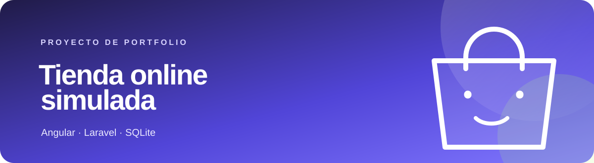
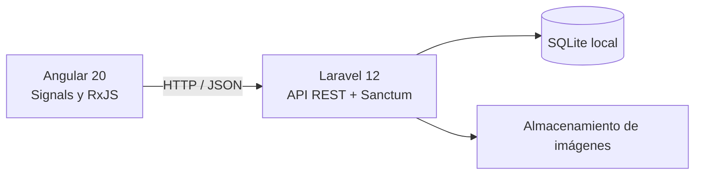

<div align="center">



[](https://angular.dev/)
[](https://laravel.com/)
[](https://www.php.net/)
[](https://www.sqlite.org/)

**Una tienda de portfolio de principio a fin:** catálogo, cesta, pedidos y administración.

</div>

## Sobre el proyecto

Aplicación web que simula la experiencia de una tienda online. El frontend Angular consume una API REST desarrollada con Laravel; para ejecutarla en local, los datos se guardan en SQLite.

> Es una simulación: no procesa pagos reales ni se conecta con una pasarela de pago.

## Qué puedes hacer

| En la tienda | En administración |
| --- | --- |
| Explorar productos y categorías | Crear, editar y eliminar productos |
| Crear una cuenta e iniciar sesión | Gestionar categorías |
| Añadir productos a la cesta y finalizar un pedido | Consultar y gestionar pedidos |
| Editar el perfil y consultar pedidos anteriores | Administrar usuarios |
| Ver imágenes y detalles de cada producto | Subir y actualizar imágenes |

Las operaciones privadas usan autenticación con Laravel Sanctum. El backend calcula el total del pedido al confirmarlo.

## Cómo está construido



## Ejecutarlo en local

### Requisitos

- PHP 8.2 o superior y Composer
- Node.js y npm
- PowerShell para usar los comandos de esta guía

### 1. Instalar y preparar la API

Desde la carpeta raíz del proyecto:

```powershell
cd backend
composer install

if (-not (Test-Path .env)) {
    Copy-Item .env.example .env
}

if (-not (Test-Path database/database.sqlite)) {
    New-Item -ItemType File database/database.sqlite | Out-Null
}

if (Select-String -Path .env -Pattern '^APP_KEY=$' -Quiet) {
    php artisan key:generate
}

php artisan migrate
php artisan storage:link
php artisan serve --host=127.0.0.1 --port=8000
```

La API queda en `http://127.0.0.1:8000/api`. Mantén esa terminal abierta.

### 2. Instalar y arrancar Angular

Abre otra terminal PowerShell desde la raíz:

```powershell
cd frontend
npm install
npm start
```

Visita `http://localhost:4200`. En local, la configuración CORS permite `localhost:4200` y `127.0.0.1:4200`.

## Activar el panel de administración

Regístrate desde la tienda. Las cuentas nuevas son usuarios normales; no hay una cuenta admin ni credenciales de demostración preconfiguradas.

En otra terminal, abre Tinker desde `backend`:

```powershell
cd backend
php artisan tinker
```

En Tinker, cambia el rol de tu cuenta usando el correo con el que te registraste:

```php
App\Models\User::where('email', 'tu-correo@example.com')->update(['type' => 'admin']);
```

Vuelve a iniciar sesión y abre `/administration`.

## Pruebas

Desde la carpeta `backend`:

```powershell
php artisan test
```

## Estructura

```text
backend/                                  API, migraciones y almacenamiento
frontend/                                 Aplicación Angular
docs/portfolio-banner.svg                 Cabecera visual de este README
ShopLaravelAngular.postman_collection.json Colección de peticiones de la API
```

## Alcance

Está preparado como proyecto de portfolio para desarrollo local. La base SQLite y las imágenes subidas se guardan en el equipo y se excluyen de Git. Para publicarlo como servicio habría que configurar una base de datos y almacenamiento adecuados, CORS y las variables de entorno de producción.
