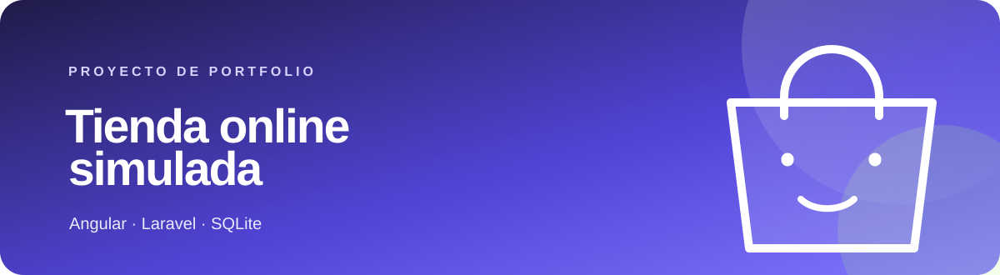
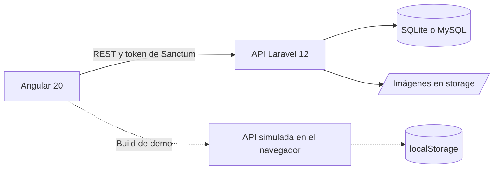

# Shop

Tienda online simulada de principio a fin: catálogo, cesta, pedidos y un panel de administración para gestionarlo todo. No procesa pagos reales.

**[Ver la demo](https://vanerb.github.io/shop-laravel-angular/)**: funciona en el navegador, sin instalar nada.



**Stack:** Angular 20 · Signals y RxJS · Laravel 12 · PHP 8.2 · Sanctum · SQLite o MySQL

## Qué puedes hacer

- **Tienda:** explorar productos por categoría, con sus imágenes y detalles.
- **Cesta y pedidos:** añadir y quitar productos, finalizar el pedido con los datos de envío y consultar los pedidos anteriores.
- **Cuenta:** registro, inicio de sesión, edición del perfil y cambio de contraseña.
- **Administración:** crear, editar y borrar productos y categorías, subir imágenes, gestionar pedidos y administrar usuarios.

Ver el catálogo es público; comprar exige iniciar sesión y la administración, una cuenta de administrador.

## Demo

La demo es el frontend compilado en modo `demo`: la API de Laravel se sustituye por una simulada dentro del navegador (`frontend/src/app/demo/`). Tus cambios se guardan en el `localStorage` de tu navegador y el botón del aviso inferior vuelve a los datos iniciales.

| Correo | Tipo de cuenta |
| --- | --- |
| `cliente@shop.demo` | Cliente |
| `admin@shop.demo` | Administración |

La contraseña de las dos es `Demo1234`. También puedes registrar cuentas nuevas.

## Cómo está construido



```text
backend/       API de Laravel: controladores, modelos, migraciones y tests
frontend/      Web de Angular y build de demo
database/      Base de datos de prueba para MySQL
docs/          Imagen de cabecera de este README
ShopLaravelAngular.postman_collection.json   Colección de peticiones de la API
```

## Decisiones técnicas

- **El total lo calcula el servidor.** Al confirmar un pedido, la API suma los precios de la base de datos; nunca se fía del total que envía el navegador.
- **Cada cesta es de su dueño.** Las rutas privadas usan tokens de Sanctum y comprueban que la cesta, el perfil o el pedido pertenecen a quien los pide; la administración exige además el rol de administrador.
- **Sin base de datos que instalar.** Por defecto usa SQLite, así que el proyecto arranca con un fichero local; para MySQL basta con cambiar las variables de entorno.
- **Accesos limitados.** El registro y el inicio de sesión tienen límite de intentos por minuto.

## Puesta en marcha

Necesitas PHP 8.2 o superior con Composer y Node.js 20.19 o superior. Los comandos de la API están escritos para PowerShell.

**API**, en `http://127.0.0.1:8000/api`:

```powershell
cd backend
composer install
if (-not (Test-Path .env)) { Copy-Item .env.example .env }
if (-not (Test-Path database/database.sqlite)) { New-Item -ItemType File database/database.sqlite | Out-Null }
if (Select-String -Path .env -Pattern '^APP_KEY=$' -Quiet) { php artisan key:generate }
php artisan migrate
php artisan storage:link
php artisan serve --host=127.0.0.1 --port=8000
```

**Web**, en `http://localhost:4200`, desde otra terminal:

```bash
cd frontend
npm install
npm start
```

Para abrir la demo en local, sin backend: `npm run start:demo`.

### Configuración

La API se configura en `backend/.env`, que se crea a partir de `backend/.env.example`:

| Variable | Por defecto | Uso |
| --- | --- | --- |
| `DB_CONNECTION` | `sqlite` | Motor de base de datos: `sqlite` o `mysql`. |
| `DB_HOST`, `DB_PORT`, `DB_DATABASE`, `DB_USERNAME`, `DB_PASSWORD` | Sin valor | Conexión con MySQL, si se usa. |
| `CORS_ALLOWED_ORIGINS` | `http://localhost:4200`, `http://127.0.0.1:4200` | Orígenes que pueden llamar a la API. |

### Datos de prueba

Con SQLite el proyecto arranca vacío. Para tener datos inventados, [`database/shop_prueba.sql`](database/shop_prueba.sql) crea la base `shop_demo` en MySQL o MariaDB con productos, categorías y pedidos. No borra nada: si las tablas ya existen, la importación se detiene con un error.

```bash
mysql -u root -p --default-character-set=utf8mb4 -e "source database/shop_prueba.sql"
```

Después, en `backend/.env`, pon `DB_CONNECTION=mysql`, `DB_DATABASE=shop_demo` y tus datos de conexión.

Cuentas: `admin@shop.test` (administración), `clara@shop.test` y `tomas@shop.test`. La contraseña de todas es `Usuario123*`. Es pública, así que no uses estas cuentas fuera de un entorno local.

Si empiezas con la base vacía, las cuentas que registras son de cliente. Para convertir una en administradora, desde `backend`:

```bash
php artisan tinker --execute="App\Models\User::where('email', 'tu-correo@example.com')->update(['type' => 'admin']);"
```

## Tests

```bash
cd backend
php artisan test
```

Los tests de la API comprueban el registro y sus errores, el inicio de sesión, la compra con el total calculado en el servidor, que nadie pueda leer la cesta de otra persona, la edición del perfil y que la lista de usuarios solo la vea la administración.

## Limitaciones conocidas

- Es una simulación: no se conecta con ninguna pasarela de pago.
- El frontend no tiene tests propios, solo las pruebas que genera Angular.
- La base SQLite y las imágenes se guardan en el equipo, así que un despliegue real necesitaría base de datos y almacenamiento propios.

## Autoría

Proyecto de portfolio de **Vanesa Ribera Bautista** ([vanerb](https://github.com/vanerb)).
